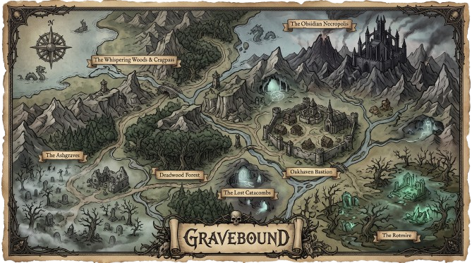

# Gravebound: Лор та Сюжет (v2, під загальну карту)

> Головна зміна проти v1: сюжет тепер прив'язаний до **реальної карти гри** (7 локацій), а не до вигаданих Каер-Дуна, Кар-Тора та вулкана, яких на карті немає. Сюжет **масштабується**: його можна зібрати з 1, 2 або 3 боссів і він завжди має кінець.

---

## 1. Світ: Валґард

Колись **Валґард** був імперією білого каменю. Сила імперії трималася на **Ефірному Вогні** — первісній магії, що тримала баланс між живими й мертвими. Верховний архімаг **Мор-Гул** порушив заборону: відчинив **Врата Могильного Провалля** і розбив **Чашу Ефірного Вогню**. Настало **Велике Затемнення**, з неба випав **Мертвий Попіл**. Хто торкався попелу — помирав і вставав слугою темряви.

Уламки Чаші розлетілися по землі. Мор-Гул замкнувся в **Обсидіановому Некрополі** і чекає, поки Попіл допоможе йому зробити те, що не вдалося: **стати новим Ефірним Вогнем** і правити вічно.

## 2. Орден Могилонароджених

Останні верховні лицарі принесли себе в жертву на жертовниках попелу й прив'язали душі до рунічних **обелісків**:

> *«Смерть не візьме нас, доки попіл панує над Валґардом.*
> *Ми поляжемо в пилу — і повстанемо зі сталі.*
> *Наш клинок — закон спокою, наша броня — попіл предків.»*

Гравець — один із останніх пробуджених. **Смерть не фінальна**: душа повертається до найближчого обеліска (це і є наша механіка респавну).

---

## 3. Карта: що де знаходиться

| Локація на карті | Роль у грі | Біом / настрій | Вороги | Бос / ключова подія | Пакет |
| :--- | :--- | :--- | :--- | :--- | :---: |
| **The Ashgraves** (захід) | Стартова зона + туторіал | Цвинтар, туман, руїни | Скелети-воїни, лучники, ghoul | Пробудження, перший обеліск | A |
| **Oakhaven Bastion** (центр) | **Хаб**, безпечна зона | Мур, місто, жаровні | немає | NPC, торгівля, квести | A |
| **The Lost Catacombs** (південь) | Підземелля 1 | Печера, синє світло | Скелети-вартові, маги | **Хорн, Хранитель Могил** | A |
| **The Obsidian Necropolis** (північний схід) | Фінал | Чорна гора, замок, дим | Елітні кістяки, лицарі смерті | **Мор-Гул** | A |
| **Deadwood Forest** (центр-захід) | Відкрита зона, з'єднує все | Мертвий ліс, стежки | Попелясті вовки, Husks | Табір розбійників, міні-бос (опц.) | B |
| **The Whispering Woods & Cragpass** (північний захід) | Зона 2 + вежа | Ліс, скелі, міст, вежа | Шепотіння (привиди), павуки | **Едрік Заплямований** | B |
| **The Rotmire** (південний схід) | Зона 3 | Болото, зелені кристали | Rotlings, п'явки | **Мати Гнилі** | C |

Пакети: **A** = обов'язково, **B** = якщо встигаємо, **C** = бонус.

---

## 4. Хаб: Oakhaven Bastion

Єдине безпечне місце. Захищене колом священних жаровень. Колишня прикордонна фортеця імперії.

| NPC | Хто | Що дає | Характер (для озвучки) |
| :--- | :--- | :--- | :--- |
| **Старійшина Ольгерд** | Хранитель Літописів, найстарший жрець | Головні квести, лор | Втомлений, мудрий, щось приховує |
| **Коваль Бранн** | Зброяр із північних кланів | Зброя, броня, ремонт | Грубий, небагатослівний, поважає сталь |
| **Алхімік Селена** | Зіллярка, вивчає Попіл | Зілля, персні, антидоти | Тепла, але з гострим язиком |

---

## 5. Сюжет

### Ключовий механізм: Ember Gate і Уламки
Брама Некрополя запечатана **Печаттю Вогню**. Її відкривають **Уламки Чаші** — по одному від кожного боса. **Кількість Уламків, потрібних для брами = кількість зон-босів, які ми встигли зробити (1, 2 або 3).** Сюжет не ламається при скороченні скоупу.

### Пролог: Пробудження (Ashgraves)
Герой прокидається серед відкритих могил. Туман, попіл, спалахує обеліск. Голос Ольгерда: *«Якщо чуєш мене — ти ще належиш Ордену. Іди на схід, до Оакгейвена».* Туторіал: рух, атака, перший лут, перший ворог, прихід у хаб. Квест `quest_wake`.

### Акт I: Уламок у Катакомбах (пакет A)
Ольгерд пояснює: Мор-Гул вилізе з Некрополя, коли Попіл напоїть його вдосталь. Єдиний шанс — зламати печать брами зсередини, а для цього треба зібрати Уламки. Перший лежить у **Lost Catacombs**, його стереже **Хорн, Хранитель Могил** — колишній капітан королівської варти, який так і не покинув пост.

У Катакомбах герой знаходить **щоденники Мор-Гула**. З них стає зрозуміло: архімаг не мав на меті просто нищити. Він хоче вкласти власну душу в Чашу.
**Бос: Хорн** (ближній бій, щит, виклик скелетів, 2 фази). **Нагорода:** Уламок №1.

### Акт II: Зрадник (пакет B)
Через **Deadwood Forest** до **Whispering Woods & Cragpass**. У вежі над мостом засів **Командор Едрік Заплямований** — лицар Ордену, який не витримав і прийняв Попіл. Він тримає Уламок №2 і банер Ордену.
**Бос: Едрік** (важка броня, палаючий клевець, ривки; у 2-й фазі кличе шепотіння). **Нагорода:** Уламок №2.
**Сюжетний поворот:** Едрік перед смертю каже, що Ольгерд знав про план Мор-Гула ще **до** Затемнення.

### Акт III: Милосердя (пакет C)
**The Rotmire**: зелені кристали — це зіпсутий Ефірний Вогонь. Тут живе **Мати Гнилі**, колишня верховна цілителька й наставниця Селени. Селена просить не просто вбити її, а «дати спокій».
**Бос: Мати Гнилі** (отруйні калюжі, п'явки, очищення зеленим світлом). **Нагорода:** Уламок №3.

### Фінал: Obsidian Necropolis
Герой відкриває браму Уламками. Усередині чекає **Мор-Гул**. Перед боєм з'являється Ольгерд і зізнається: він був учнем Мор-Гула, допомагав створювати Врата, а Орден — це спокута.
**Бос: Мор-Гул** (2 фази):
1. **Чародій**: телепортація арено, залпи снарядів душ.
2. **Вогонь без форми**: стискання арени, Попелясті бурі, виклик кістяків.

**Кінцівка (канонічна):** Мор-Гул гине, Чаша збирається з Уламків, герой запалює Ефірний Вогонь. Душі Ордену знаходять спокій, обеліски гаснуть.
*Опціонально, якщо буде час: вибір «Запалити» / «Забрати вогонь собі» (дві короткі текстові сцени).*

---

## 6. Квести

| ID | Назва | Квестодавець | Мета | Нагорода | Пакет |
| :--- | :--- | :--- | :--- | :--- | :---: |
| `quest_wake` | Пробудження в Попелі | Ольгерд | Дійти до Оакгейвена, вбити 5 скелетів | 60 золота, 120 XP | A |
| `quest_steel` | Сталь для Варти | Бранн | Знайти Зачарований Залізний Меч у Катакомбах | 100 золота, 200 XP, Оковані Лати | A |
| `quest_ashbloom` | Попелолист | Селена | Зібрати 5 рослин Попелолисту в Ashgraves | 80 золота, 150 XP, зілля | A |
| `quest_obelisks` | Обеліски Предків | Ольгерд | Активувати обеліски в 3 регіонах | 150 золота, 300 XP, Великий Еліксир | A |
| `quest_shard1` | Перший Уламок | Ольгерд | Перемогти Хорна, принести Уламок | 250 золота, 450 XP, Перстень Полум'я | A |
| `quest_final` | Брама Некрополя | Ольгерд | Відкрити браму, знищити Мор-Гула | Кінцівка | A |
| `quest_edrik` | Тінь Командора | Ольгерд | Перемогти Едріка | 350 золота, 600 XP, унікальний | B |
| `quest_mercy` | Милосердя | Селена | Перемогти Матір Гнилі | 400 золота, 700 XP, унікальний | C |

Знаки над NPC: золоте **`[!]`** — квест доступний, смарагдове **`[?]`** — можна здати. Журнал — клавіша **`L`**.

---

## 7. Лор-фрагменти (колекційні записи в журналі)

| # | Назва | Де знаходиться | Зміст |
| :-: | :--- | :--- | :--- |
| 1 | Останній запис літопису | Ashgraves | Опис Великого Затемнення очима простого писаря. |
| 2 | Обітниця Ордену | Oakhaven | Повний текст клятви Могилонароджених. |
| 3 | Щоденник Мор-Гула, ч. 1 | Catacombs | Він писав про «вічність», не про владу. |
| 4 | Щоденник Мор-Гула, ч. 2 | Catacombs | Згадка про «першого учня, що відмовився». |
| 5 | Лист Едріка | Cragpass | Чому він прийняв Попіл. |
| 6 | Нотатки цілителів | Rotmire | Як Вогонь гниє, коли немає кому його берегти. |

---

## 8. Текстові потреби (для озвучки та UI)

- Усі діалоги короткі: **до 3 реплік на NPC за один квест**.
- Озвучка (Соня) — тільки ключові репліки: прокидання героя, привітання NPC, вступ і смерть кожного боса, фінал. Решта — текстом.
- Кожній репліці присвоюється ID у форматі `vo_<npc>_<номер>` (наприклад `vo_olgerd_03`), щоб код і аудіо збігалися.
